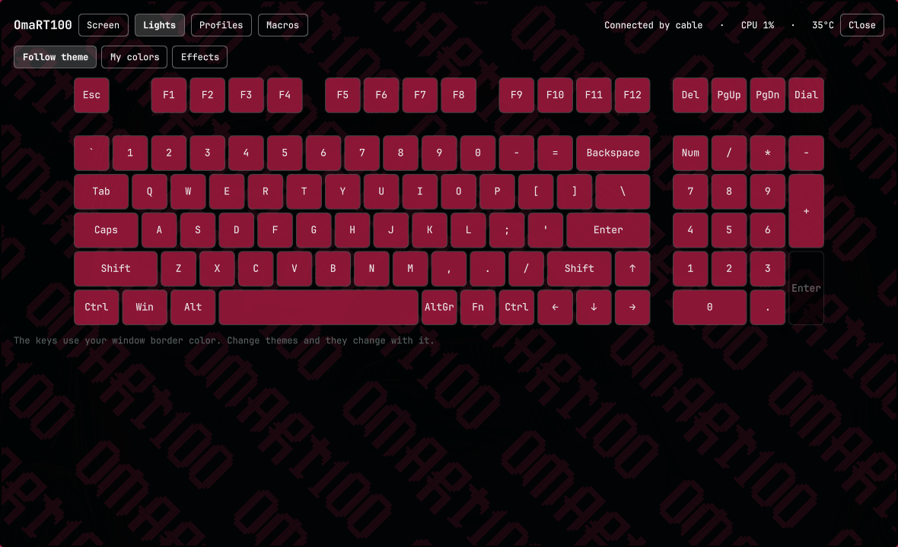
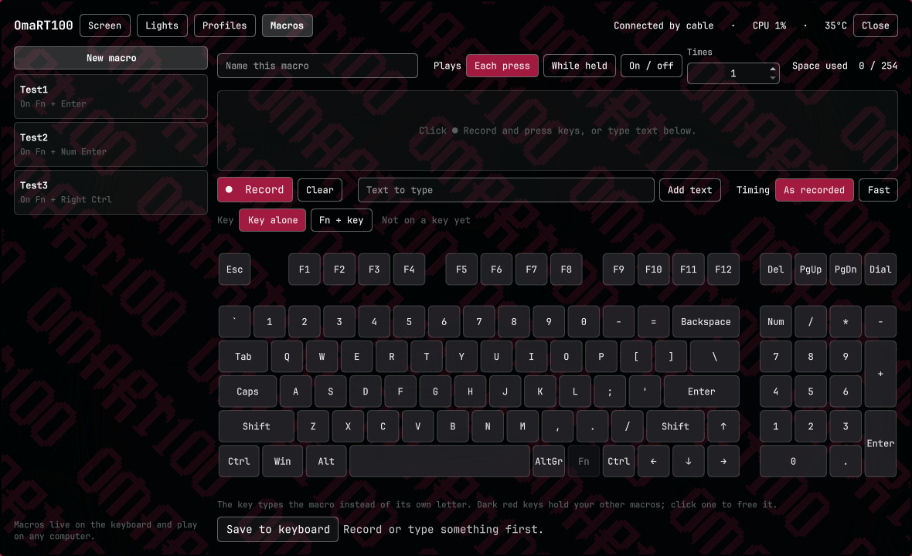
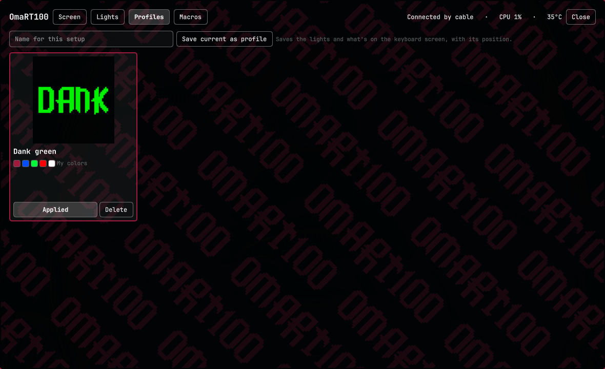
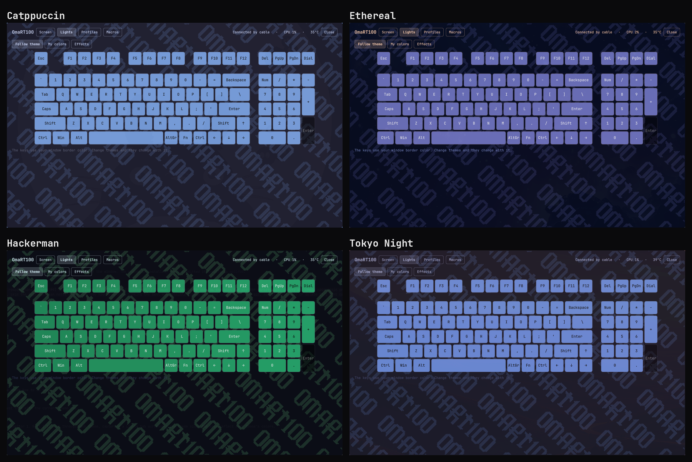
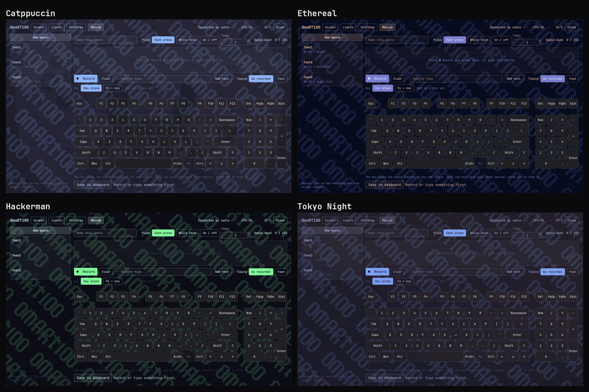

# OmaRT100

a keyboard manager for my Epomaker RT100, made for [Omarchy](https://omarchy.org).

Epomaker doesn't make a Linux app (just Windows, Mac and a web one that needs
Chrome), so on Omarchy i had no way to change my key colors or get my
wallpaper back on the keyboard's little screen. so i made my own. it does the
screen, the lights, profiles and macros, and it all follows my Omarchy theme.

it's built for the RT100 specifically. if you've got one too, it should work
for you.



## what it does

it opens as a big window in the middle of the screen with four tabs:

- **Screen**: drag a picture or gif onto the window, paste a link (GIPHY page
  links work), or pick a file. move it and zoom it how you like, then send it
  to the keyboard's screen. the left side shows what's on the keyboard right
  now.
- **Lights**: the keys can follow your theme's window border color (if your
  theme has a gradient border, it spreads across the keyboard left to right).
  or paint your own colors, key by key or a whole group at once (WASD, arrows,
  F keys, numbers, letters, number pad) with swatches or a full color picker,
  then send it all in one go. the keyboard's 19 built in effects are in there
  too.
- **Profiles**: save the lights and the screen picture together, then switch
  between setups with one click.
- **Macros**: record keys or type text, pick how it plays (each press, while
  held, or on/off), and put it on a key or on Fn + a key.





everything follows the theme, the keys on the keyboard included. here it is
in Catppuccin, Ethereal, Hackerman and Tokyo Night:





a small helper runs in the background while the shell is up. it keeps the
CPU and temp on the keyboard screen live and the clock in sync, and when you
change themes the keys change with it.

the macros get saved on the keyboard itself, so the keyboard plays them on
its own. they work on any computer, even without this running. delete one
and the key goes back to how it was.

## your keyboard

this is for the Epomaker RT100 plugged in with the **USB cable** (USB
`3151:4015`, also `3151:4010`). check with:

```bash
lsusb | grep 3151:401
```

flip the mode switch on the keyboard to **Off** (wired). over the 2.4 GHz
dongle or Bluetooth the keyboard ignores all of this.

US ANSI layout, tested on firmware 1.08.

## install

you need Omarchy 4, the keyboard plugged in by cable, and these packages
(Omarchy already has most of them): `python`, `python-pillow`, `zenity`,
`util-linux`.

**1. add the plugin.**

```bash
omarchy plugin add https://github.com/Dankestrick/OmaRT100.git --enable
```

that clones into `~/.config/omarchy/plugins/io.github.dankestrick.omart100/`.

**2. let your session talk to the keyboard (one time, needs root).** the
keyboard's settings channel is a `/dev/hidraw` node that only root can open
until a udev rule allows it. the rule comes with the plugin in
[`udev/70-omart100.rules`](udev/70-omart100.rules), so you can read it first.
copy it into place and reload udev:

```bash
sudo install -m 0644 ~/.config/omarchy/plugins/io.github.dankestrick.omart100/udev/70-omart100.rules /etc/udev/rules.d/
sudo udevadm control --reload-rules && sudo udevadm trigger
```

then unplug the keyboard's cable and plug it back in. this is the only step
that needs root. [Permissions and safety](#permissions-and-safety) says
exactly what it allows.

don't symlink a git checkout into the plugins folder. Omarchy rejects a
plugin folder that's a symlink.

## open it

```bash
omarchy-shell shell toggle io.github.dankestrick.omart100 '{}'
```

run it again to close the window, or hit `Esc` or SUPER + W. to open straight
to a tab, pass its name: `'{"tab":"macros"}'` (`screen`, `lights`,
`profiles`, `macros`).

i put it on a key. add a line like this to `~/.config/hypr/bindings.lua`:

```lua
o.bind("SUPER + K", "OmaRT100", "omarchy-shell shell toggle io.github.dankestrick.omart100 '{}'")
```

## using it

### screen

drag a picture or gif from your file manager onto the window, paste a link
and hit **Open link**, or hit **Choose file…**. then place it: drag to move,
scroll to zoom, or use the arrow and zoom buttons, and hit **Send to
keyboard**. a still picture takes about 8 seconds, a gif up to 30. pictures
fill the screen (162 × 173), gifs play at up to 128 × 160 and 56 frames.

### lights

in **My colors**, painting only changes the map in the window. hit **Send to
keyboard** when you're ready, or **Undo changes** to go back to what the
keyboard has. the keyboard needs a moment between color changes, so it spaces
them out for you. Numpad Enter has no light.

### macros

1. hit **New macro** and give it a name.
2. hit **● Record**, press your keys, then **■ Stop**. or type into **Text to
   type** and hit **Add text**. click a step to remove it.
3. pick how it plays: **Each press** (and how many times), **While held**, or
   **On / off**. **As recorded** keeps your timing, **Fast** packs it tight.
4. pick **Key alone** or **Fn + key**, then click a key on the map.
5. hit **Save to keyboard**.

**Key alone** replaces what the key types. **Fn + key** keeps the key's
normal job and plays the macro when you hold Fn. dimmed keys already do
something with Fn (media keys, wireless modes and so on) so you can't pick
them, and the Fn key itself never changes. dark red keys already hold one of
your macros, click one to free it. the **Space used** counter shows how much
of the keyboard's 254 bytes the macro takes as you go. recording happens
inside the window, so shortcuts Hyprland grabs (like SUPER + something)
can't be recorded.

## Permissions and safety

OmaRT100 runs as a normal Omarchy plugin, with your user's permissions.

- **One root step, at install.** Step 2 copies one udev rule into
  `/etc/udev/rules.d/`. After that, nothing needs root. At runtime, OmaRT100
  does not use sudo or pkexec. It installs no services.
- **What the rule allows.** It matches only the RT100's hidraw nodes (USB
  `3151:4010` and `3151:4015`) and tags them `uaccess`, which gives the user at
  the active local session read and write access, the same way Linux handles
  game controllers. No other device is affected.
- **What it talks to.** Only the keyboard's control interface (USB interface
  2). Interface 0 carries your typing; OmaRT100 never opens it and never sees
  what you type. Macro recording reads keys only while the window has focus
  and you have pressed **Record**, and a recorded macro goes to the helper
  over stdin, never on a command line.
- **Network.** Only when you give it a link: it downloads that picture or GIF
  (for a GIPHY page, the GIF behind it), with a 30 second timeout and a 25 MB
  limit.
- **What it runs.** Its own helper (`helpers/omart100ctl`, plain Python) for as
  long as the shell runs; it ends with the shell. Commands go to the helper
  as argument lists, never through a shell. `zenity` opens the file picker.
- **What it writes.** On disk, only `~/.local/state/omart100/` (0700; settings
  and macros files 0600): settings, profiles, macros, and a copy of what's on
  the screen. Socket: `$XDG_RUNTIME_DIR/omart100.sock`, private to you (0600).
- **What it changes on the keyboard.** Lights, the screen picture, macro
  slots 1 to 32, and the keys you put macros on. Before changing a key it
  saves what the key did, and puts that back when you delete the macro.

## if something's off

| what you see | fix |
| --- | --- |
| "Keyboard not found" | plug in the cable and set the switch to Off. check that `lsusb` lists `3151:4015`. |
| "Can't open /dev/hidraw…" | do install step 2, then unplug and replug the cable. |
| the whole keyboard went plain white | it got color changes too fast. pick the lights again in the Lights tab. |
| the picture only half shows | send it again and leave the keyboard alone until it finishes. |
| a macro key types its old letter | the macro's on another of the keyboard's own profiles. switch back, or save the macro again. |

the helper works from a terminal too:

```bash
python3 ~/.config/omarchy/plugins/io.github.dankestrick.omart100/helpers/omart100ctl status
```

## remove

delete your macros first (Macros tab, **Delete macro**) so their keys go back
to normal. then:

```bash
omarchy plugin remove io.github.dankestrick.omart100 --yes
```

Omarchy keeps a backup copy named
`~/.config/omarchy/plugins/.io.github.dankestrick.omart100.bak.<date>`, which
you can delete. to remove your saved settings, profiles and macro list too:

```bash
rm -rf ~/.local/state/omart100
```

removing the udev rule needs root, same as installing it:

```bash
sudo rm -f /etc/udev/rules.d/70-omart100.rules
sudo udevadm control --reload-rules && sudo udevadm trigger
```

## credits

this wouldn't exist without these folks working out the keyboard first:

- screen, light and effect commands:
  [strodgers/epomaker-controller](https://github.com/strodgers/epomaker-controller) (MIT)
- key positions started from
  [dwaycik/epomaker-rt100](https://github.com/dwaycik/epomaker-rt100) (MIT).
  i fixed the bottom row and key slots on my own keyboard.
- macro and key commands:
  [ramarivera/epomaker-driver-linux](https://github.com/ramarivera/epomaker-driver-linux) (MIT)

OmaRT100 isn't made by or affiliated with Epomaker.

## license

[MIT](LICENSE)
